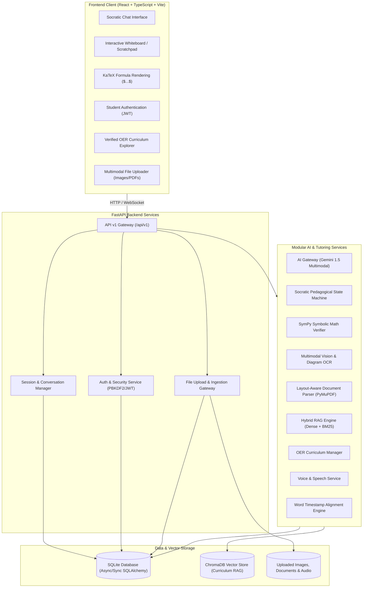

# AI-Powered Multimodal Student Tutor & Problem Solver

An intelligent, multi-turn, multimodal tutoring system engineered to guide students through complex STEM problems using the Socratic method, mathematical verification, diagram comprehension, and voice interaction.

---

## 🏛️ System Architecture



---

## 📁 Project Directory Structure

```text
ai-multimodal-tutor/
├── backend/
│   ├── app/
│   │   ├── api/
│   │   │   └── v1/
│   │   │       ├── endpoints/
│   │   │       │   ├── auth.py          # Student registration, login, /me JWT verification
│   │   │       │   ├── user.py          # Student profile management & dashboard analytics
│   │   │       │   ├── health.py        # System health & DB readiness endpoint
│   │   │       │   ├── session.py       # Tutoring session & message CRUD (Conversations)
│   │   │       │   └── ingest.py        # Multimodal ingestion: text, images, PDF, DOCX, audio, video
│   │   │       └── router.py            # Aggregated v1 API router
│   │   ├── core/
│   │   │   ├── config.py                # Pydantic Settings & environment config
│   │   │   ├── file_security.py         # MIME validation, size limits & sanitization
│   │   │   ├── logging.py               # Structured application logger
│   │   │   └── security.py              # PBKDF2 password hashing & HMAC-SHA256 JWT
│   │   ├── db/
│   │   │   ├── base.py                  # SQLAlchemy declarative base
│   │   │   └── session.py               # Synchronous SQLite session provider
│   │   ├── models/
│   │   │   ├── user.py                  # User / Student profile ORM model
│   │   │   ├── session.py               # StudySession & SessionMessage ORM models
│   │   │   └── asset.py                 # UploadedAsset ORM model
│   │   ├── schemas/
│   │   │   ├── health.py                # Health check response schemas
│   │   │   ├── auth.py                  # Login, registration, token schemas
│   │   │   ├── user.py                  # User profile schemas
│   │   │   ├── session.py               # Session & Message request/response schemas
│   │   │   ├── asset.py                 # Uploaded file schemas
│   │   │   └── unified_input.py         # UnifiedQuestionPayload, SourceFileInfo & schemas
│   │   ├── services/
│   │   │   ├── text_normalizer.py       # Whitespace & LaTeX bracket normalization
│   │   │   ├── image_processor.py       # Image preprocessing & Gemini vision OCR
│   │   │   ├── pdf_processor.py         # PyMuPDF page-aware extraction & table parser
│   │   │   ├── docx_processor.py        # python-docx structured hierarchy parser
│   │   │   ├── audio_processor.py       # Audio STT with Gemini & offline fallback
│   │   │   ├── video_processor.py       # 30s keyframe sampling & multimodal audio/visual fusion
│   │   │   └── unified_pipeline.py      # Master input router to UnifiedQuestionPayload
│   │   └── main.py                      # FastAPI app factory, CORS & lifespan
│   ├── tests/
│   │   ├── conftest.py                  # Pytest fixtures & test client
│   │   ├── test_api.py                  # Health, Auth, Session & Upload test suite
│   │   └── test_multimodal.py           # Comprehensive multimodal ingestion test suite
│   ├── requirements.txt                 # Backend Python dependencies
│   ├── pytest.ini                       # Pytest test runner config
│   └── .env.example                     # Backend environment template
├── frontend/
│   ├── src/
│   │   ├── components/
│   │   │   ├── AuthModal.tsx            # Student sign in & account registration
│   │   │   ├── ChatInterface.tsx        # Multi-turn chat with LaTeX math rendering
│   │   │   ├── CurriculumView.tsx       # Verified OER curriculum explorer
│   │   │   ├── FileUploadModal.tsx      # Image, PDF & worksheet uploader
│   │   │   ├── Header.tsx               # App header with live backend status & auth
│   │   │   ├── MathRenderer.tsx         # KaTeX formula renderer for $...$ and $$...$$
│   │   │   ├── ProfileModal.tsx         # User profile and learning progress
│   │   │   ├── SessionList.tsx          # Study sessions sidebar with creation modal
│   │   │   ├── TutorResponse.tsx        # Socratic markdown answer display with KaTeX & code
│   │   │   ├── VoicePlayer.tsx          # Audio playback dock with sentence highlighting
│   │   │   └── WhiteboardCanvas.tsx     # Interactive student scratchpad & canvas
│   │   ├── pages/
│   │   │   ├── LandingPage.tsx          # Landing page with feature highlights & hero
│   │   │   ├── LoginPage.tsx            # Full-page login interface
│   │   │   ├── RegisterPage.tsx         # Registration interface with grade/subject selection
│   │   │   └── StudentDashboard.tsx     # Student dashboard with metrics & active sessions
│   │   ├── services/
│   │   │   └── api.ts                   # Type-safe API client (Auth, Sessions, Uploads)
│   │   ├── types/
│   │   │   └── index.ts                 # Shared TypeScript interfaces
│   │   ├── App.tsx                      # Main application view & tab coordinator
│   │   ├── index.css                    # Tailwind CSS base & utilities
│   │   ├── vite-env.d.ts                # Vite environment typings
│   │   └── main.tsx                     # React DOM entrypoint
│   ├── package.json                     # Frontend npm packages
│   ├── vite.config.ts                   # Vite bundler configuration
│   ├── tsconfig.json                    # TypeScript compiler options
│   ├── tailwind.config.js               # Tailwind styling configuration
│   └── .env.example                     # Frontend environment template
├── scripts/
│   ├── run_backend.ps1                  # PowerShell script to start FastAPI backend
│   └── run_frontend.ps1                 # PowerShell script to start Vite frontend
├── .env.example                         # Master environment variables template
├── .gitignore                           # Git ignore rules for Python, Node, DB & secrets
└── README.md                            # Comprehensive technical documentation
├── scripts/
│   ├── run_backend.ps1                  # PowerShell script to start FastAPI backend
│   └── run_frontend.ps1                 # PowerShell script to start Vite frontend
├── .env.example                         # Master environment variables template
├── .gitignore                           # Git ignore rules for Python, Node, DB & secrets
└── README.md                            # Comprehensive technical documentation
```

---

## 🚀 Getting Started

### Prerequisites
- **Python 3.11+** (Tested with Python 3.14)
- **Node.js v18+** & **npm**

### 1. Backend Setup
```bash
cd backend
python -m venv venv

# Windows PowerShell:
.\venv\Scripts\activate

# Install dependencies:
pip install -r requirements.txt

# Create environment file:
copy .env.example .env
```

### 2. Frontend Setup
```bash
cd ../frontend
npm install
copy .env.example .env
```

### 3. Running the Application

**Option A: Convenience Scripts (PowerShell)**
- Terminal 1 (Backend):
  ```powershell
  .\scripts\run_backend.ps1
  ```
- Terminal 2 (Frontend):
  ```powershell
  .\scripts\run_frontend.ps1
  ```

**Option B: Manual Commands**
- Backend:
  ```powershell
  cd backend
  .\venv\Scripts\python.exe -m uvicorn app.main:app --host 127.0.0.1 --port 8000 --reload
  ```
- Frontend:
  ```powershell
  cd frontend
  npm run dev
  ```

Interactive API documentation: [http://127.0.0.1:8000/docs](http://127.0.0.1:8000/docs).  
Application UI: [http://localhost:5173](http://localhost:5173).

---

## 🧪 Testing

To execute the backend unit test suite:
```powershell
cd backend
.\venv\Scripts\python.exe -m pytest tests/ -v
```

To build and verify the frontend application:
```powershell
cd frontend
npm run build
```

---

## 🗺️ Project Roadmap & Phase Status

| Phase | Description | Status |
| :--- | :--- | :--- |
| **Phase 0** | **Project Analysis & System Architecture** | ✅ Completed & Approved |
| **Phase 1** | **Project Setup & Foundation (FastAPI, SQLite, React, Vite, Tailwind)** | ✅ Completed & Approved |
| **Phase 2** | **Student Interface & Authentication (Dashboard, Socratic Chat, Voice Dock)** | ✅ Completed & Approved |
| **Phase 3** | **Multimodal Input Ingestion Pipeline (Text, Image, PDF, DOCX, Audio, Video)** | ✅ Completed (Awaiting Approval) |
| **Phase 4** | **Socratic Tutoring Engine & Symbolic Math Verification (SymPy + Gemini)** | ⏳ Queued for Phase 4 |
| **Phase 5** | **Knowledge Retrieval & Verifiable RAG System (ChromaDB + Textbook Indexing)**| ⏳ Queued |
| **Phase 6** | **Conversational Voice Pipeline & Synchronized Subtitles** | ⏳ Queued |
| **Phase 7** | **Document Summarization, Practice Questions & MCQ Generation** | ⏳ Queued |
| **Phase 8** | **Student Mastery Analytics & Multi-Session Memory** | ⏳ Queued |
| **Phase 9** | **End-to-End Testing, Security Hardening & Documentation** | ⏳ Queued |

---

## 📥 Phase 3: Multimodal Ingestion Pipeline

The multimodal ingestion layer normalizes all student input channels into a single standardized schema: `UnifiedQuestionPayload`.

### 1. Ingestion Endpoints (`/api/v1/ingest/`)
- `POST /text`: Whitespace cleaning, bracket LaTeX delimiter conversion (`\[...\]` $\rightarrow$ `$$...$$`, `\(...\)` $\rightarrow$ `$`), equation detection, and academic domain routing.
- `POST /image`: Pillow contrast stretching, auto-orientation deskew, Gemini 1.5 Flash Vision OCR extracting handwritten formulas and geometric diagrams.
- `POST /pdf`: PyMuPDF layout-aware text extraction, table extraction (`find_tables`), page-indexed academic citation anchors.
- `POST /docx`: `python-docx` heading hierarchy parsing, table restructuring into markdown grids, paragraph grouping.
- `POST /audio`: Direct Gemini multimodal audio STT with offline fallback and student transcript confirmation flag.
- `POST /video`: 30-second keyframe sampling strategy, visual blackboard OCR + audio track transcription fusion, timestamped reference anchors.
- `POST /unified`: Master polymorph endpoint detecting MIME category automatically and dispatching to the appropriate parser.

### 2. File Security Safeguards (`app/core/file_security.py`)
- **Strict Size Limits:** Text (64 KB), Image (20 MB), PDF (50 MB), DOCX (25 MB), Audio (25 MB), Video (100 MB).
- **MIME & Extension Enforcement:** Whitelist-based validation preventing executable uploads and spoofed extensions.
- **Path Sanitization:** Filename sanitization with UUID prefixes preventing directory traversal.
- **Temporary Cleanup:** Automatic resource cleanup on failed extractions.
