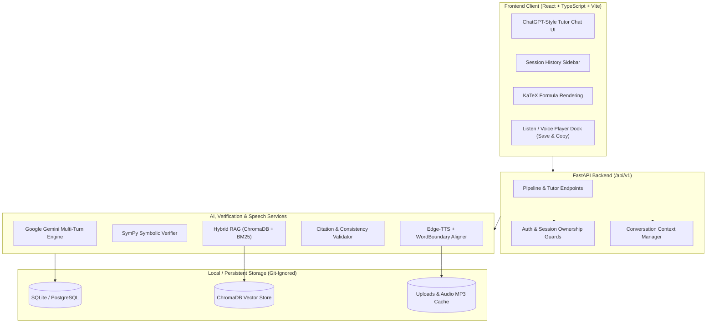

# AI-Powered Multimodal Student Tutor & Problem Solver

A full-stack, personal AI tutoring platform built with **FastAPI**, **React + TypeScript**, **Google Gemini**, **SymPy**, **ChromaDB**, and **Neural Edge-TTS**. Designed with a clean ChatGPT-style interface, it helps students understand STEM and programming concepts step-by-step with multi-turn conversation memory, LaTeX math rendering, code analysis, multimodal uploads, and synchronized read-aloud voice playback.

---

## Project Overview

This application acts as a personal one-on-one tutor rather than a search or dictionary lookup tool:
- Explains topics in student-friendly, structured Markdown adapted to **Beginner**, **Intermediate**, and **Advanced** depth levels.
- Preserves **session-isolated multi-turn memory**, resolving natural follow-up prompts (`"example"`, `"why?"`, `"give code"`, `"explain line by line"`, `"give me a practice question"`) cleanly within the active conversation thread without leaking context between sessions or users.
- Verifies explicit algebra, calculus, and arithmetic steps symbolically using **SymPy** before presenting step-by-step derivations.
- Supports **Listen**, **Save**, and **Copy** controls on tutor responses, complete with math-normalized speech and word-level synchronized highlighting.

---

## Main Features

- **Google Gemini Conversational Tutor:** Powered by `google-genai` using multi-turn conversation history and custom educational system instructions. Fails explicitly with actionable API error messages rather than falling back to canned dictionary or Wikipedia text.
- **Session & User Isolation:** Persistent study sessions stored in SQLite/PostgreSQL (`StudySession`, `SessionMessage`) with per-user ownership enforcement (`403 Forbidden` on unauthorized cross-user access) and isolated guest namespaces.
- **Symbolic Math & Safe AST Code Verification:**
  - `SymPy` computes exact rational arithmetic, quadratic roots, derivatives, integrals, limits, and statistics.
  - Python `ast` static analyzer evaluates time complexity and syntax safety without executing arbitrary code.
- **Multimodal Question Ingestion (`/api/v1/ingest`, `/api/v1/pipeline/execute-file`):** Processes text, printed/handwritten images, PDFs (`PyMuPDF`), Word documents (`python-docx`), audio, and video clips into normalized student queries.
- **Neural Text-to-Speech & Subtitle Sync (`/api/v1/voice`):** Synthesizes natural voices via `edge-tts`, converts LaTeX equations (`$...$`, `$$...$$`), tables, and code blocks into natural spoken phrasing, and aligns highlighted words to audio playback.
- **On-Demand Hybrid RAG Curriculum Grounding (`/api/v1/knowledge`, `/api/v1/rag`):** Combines ChromaDB dense vector search and Okapi BM25 sparse search with Reciprocal Rank Fusion (RRF), attaching verified references when curriculum sources or citations are requested.
- **Answer Validation Layer (`/api/v1/validation`):** Checks factual grounding, citation integrity, symbolic math consistency, and Python code safety while preserving programming syntax and conversational follow-ups.
- **Production Security & Deployment Ready:** Sliding-window rate limiting middleware, security headers (`nosniff`, `DENY`, `HSTS`), sensitive-data log masking, Dockerfiles, Nginx config, and `docker-compose` setups.

---

## Technologies Used

### Backend
- **Framework:** FastAPI, Uvicorn, Gunicorn (Linux production)
- **LLM & AI:** Google GenAI SDK (`google-genai`)
- **Database & ORM:** SQLAlchemy, SQLite (local dev), PostgreSQL (`psycopg2-binary` in prod)
- **Math & Code Analysis:** SymPy, Python `ast`
- **RAG & Document Processing:** ChromaDB, Rank-BM25, NumPy, PyMuPDF (`fitz`), python-docx, Pillow, BeautifulSoup4
- **Voice & Audio:** Edge-TTS (`edge-tts`)
- **Validation & Config:** Pydantic v2, `pydantic-settings`, `python-dotenv`, HTTPX
- **Testing:** Pytest, `pytest-asyncio`

### Frontend
- **Framework:** React 18, TypeScript, Vite 5
- **Styling & Icons:** Tailwind CSS 3, Lucide React, `clsx`, `tailwind-merge`
- **Math Rendering:** KaTeX

---

## Model & AI Configuration

| Component | Model / Engine | Purpose |
| :--- | :--- | :--- |
| **Primary Tutor LLM** | `gemini-3.5-flash-lite` (configurable via `GEMINI_MODEL`) | Fast multi-turn conversational tutoring, explanations, code generation, and practice questions |
| **Fallback LLM Chain** | `gemini-3.1-flash-lite`, `gemini-3.5-flash`, `gemini-3.6-flash` | Automatic model-level failover on transient unavailability/deprecation (`404`/`503`/`504`/`429`) |
| **Symbolic Math Engine** | `SymPy 1.14` | Deterministic verification of equations, derivatives, integrals, limits, and statistics |
| **Curriculum Embeddings** | `text-embedding-004` + deterministic 768-dim local hashing | Dense semantic search inside ChromaDB |
| **Voice Synthesis** | Edge-TTS (`en-US-AriaNeural`, `en-US-GuyNeural`, `en-US-JennyNeural`, `en-US-ChristopherNeural`) | Neural speech generation with `WordBoundary` timestamp alignment |

---

## Dataset & Knowledge Base Information

No large raw datasets or binary databases are committed to this repository. Instead:
- The authoritative curriculum metadata registry (`backend/app/services/knowledge_sources.py`) defines open educational sources including **NCERT**, **ePathshala**, **NPTEL**, **OpenStax**, **MIT OpenCourseWare**, **LibreTexts**, **Python 3 Docs**, and **arXiv**.
- Documents uploaded or ingested through `POST /api/v1/knowledge/documents/ingest` are cleaned, semantically chunked with math formula preservation, hashed against duplicates (`sha256`), and indexed locally into ChromaDB (`backend/storage/vector_store`) and SQLite (`backend/tutor.db`), both excluded by `.gitignore`.

---

## Project Directory Structure

```text
ai-tutor/
├── backend/
│   ├── app/
│   │   ├── api/v1/endpoints/        # auth, health, ingest, knowledge, pipeline, rag, session, tutor, user, validation, voice
│   │   ├── core/                    # config, file_security, logging, rate_limiter, security, security_headers
│   │   ├── db/                      # SQLAlchemy Base & SessionLocal
│   │   ├── models/                  # ORM models: User, StudySession, SessionMessage, UploadedAsset, Knowledge tables
│   │   ├── schemas/                 # Pydantic v2 request/response contracts
│   │   ├── services/                # tutor_engine, context_manager, pipeline_orchestrator, rag_*, sympy_solver, voice_*
│   │   └── main.py                  # FastAPI application entrypoint
│   ├── tests/                       # Comprehensive unit, integration, security, voice, RAG & Gemini memory tests
│   ├── .env.example                 # Backend environment template
│   ├── Dockerfile                   # Multi-stage non-root backend image
│   ├── gunicorn_conf.py             # Production Gunicorn worker config
│   ├── pytest.ini                   # Pytest configuration
│   └── requirements.txt             # Backend Python dependencies
├── docs/                            # Detailed architecture, API, DB, RAG, deployment, voice & QA documentation
├── frontend/
│   ├── src/
│   │   ├── components/              # ChatInterface, TutorResponse, SessionList, Header, VoicePlayer, AuthModal, etc.
│   │   ├── pages/                   # LandingPage, LoginPage, RegisterPage, StudentDashboard
│   │   ├── services/api.ts          # Type-safe REST API client
│   │   ├── types/index.ts           # Shared TypeScript types
│   │   └── App.tsx                  # Root ChatGPT-style app layout & state management
│   ├── .env.example                 # Frontend API URL template
│   ├── Dockerfile                   # Nginx multi-stage frontend image
│   ├── nginx.conf                   # Production reverse-proxy & SPA routing rules
│   ├── package.json                 # Node dependencies & build scripts
│   └── vite.config.ts               # Vite config
├── scripts/
│   ├── demonstration_walkthrough.py # Automated 10-step feature walkthrough
│   ├── run_backend.ps1              # Windows PowerShell backend launcher
│   └── run_frontend.ps1             # Windows PowerShell frontend launcher
├── .env.example                     # Root environment template
├── .env.production.example          # Production environment template (placeholders only)
├── .gitignore                       # Git exclusions for venvs, .env secrets, node_modules, logs, DBs & storage
├── docker-compose.yml               # Local containerized stack
├── docker-compose.prod.yml          # Production PostgreSQL + FastAPI + Nginx stack
├── requirements.txt                 # Root dependency pointer (-r backend/requirements.txt)
└── README.md
```

---

## System Architecture



---

## Installation & Setup

### Prerequisites
- **Python 3.11+** (tested on Python 3.14)
- **Node.js 18+** & **npm**
- A **Google Gemini API key** from Google AI Studio

### 1. Clone the Repository
```bash
git clone <your-github-repo-url>
cd ai-tutor
```

### 2. Backend & Virtual Environment Setup

#### Windows (PowerShell)
```powershell
cd backend
python -m venv venv
.\venv\Scripts\Activate.ps1
python -m pip install --upgrade pip
pip install -r requirements.txt
copy .env.example .env
```

#### macOS / Linux
```bash
cd backend
python3 -m venv venv
source venv/bin/activate
python -m pip install --upgrade pip
pip install -r requirements.txt
cp .env.example .env
```

*(Alternatively, from the repository root with your virtual environment activated, you can run `pip install -r requirements.txt`, which references `backend/requirements.txt`.)*

Open `backend/.env` and set your Gemini API key:
```env
GEMINI_API_KEY="your_actual_gemini_api_key_here"
GEMINI_MODEL="gemini-3.5-flash-lite"
```

### 3. Frontend Setup
From the repository root:
```bash
cd frontend
npm install
```
Copy the frontend environment template:
- Windows PowerShell: `copy .env.example .env`
- macOS / Linux: `cp .env.example .env`

---

## How to Run the Project

### Local Development

**Terminal 1 — Start the Backend API:**
```powershell
# From backend/
.\venv\Scripts\python.exe -m uvicorn app.main:app --host 127.0.0.1 --port 8000 --reload
```
Or via convenience script from repo root on Windows:
```powershell
.\scripts\run_backend.ps1
```

**Terminal 2 — Start the Frontend UI:**
```bash
# From frontend/
npm run dev
```
Or via convenience script from repo root on Windows:
```powershell
.\scripts\run_frontend.ps1
```

Once both servers are running:
- **Student Chat UI:** `http://localhost:5173`
- **Swagger / OpenAPI Docs:** `http://127.0.0.1:8000/docs`

### Running with Docker
```bash
# Development container stack
GEMINI_API_KEY=your_key docker compose up --build

# Production stack (configure .env from .env.production.example first)
docker compose -f docker-compose.prod.yml up --build -d
```

---

## Testing & Verification

Run the full backend test suite (requires valid `GEMINI_API_KEY` in `backend/.env` for live Gemini integration tests):
```powershell
cd backend
.\venv\Scripts\pytest.exe -v
```
Latest verified test run: **87 / 87 tests passing**, covering API health/auth, multimodal ingestion, knowledge base & RAG, SymPy math & AST code analysis, validation & citation guards, neural voice & subtitle normalization, multi-turn conversation memory, Gemini failure reporting (zero silent fallback), cross-user isolation, and end-to-end integration.

Verify the TypeScript & production frontend bundle build:
```bash
cd frontend
npm run build
```

---

## Screenshots

Add screenshots of your running UI in a `docs/screenshots/` folder if desired before publishing showcases:
- **Direct Chat Tutor View:** ChatGPT-style conversation screen with structured Markdown, KaTeX equations, code blocks, and `Listen`, `Save`, and `Copy` buttons.
- **Session History Sidebar:** Per-user/guest chat thread switcher with create, rename, and delete controls.
- **Synchronized Voice Playback Dock:** Interactive audio player with play/pause, playback speed (`0.75x`–`2.0x`), and line/word subtitle highlighting.

---

## Additional Documentation

Detailed engineering documents live in [`docs/`](docs/):
- [System Architecture](docs/SYSTEM_ARCHITECTURE.md)
- [API Documentation](docs/API_DOCUMENTATION.md)
- [Database Documentation](docs/DATABASE_DOCUMENTATION.md)
- [RAG & Knowledge Base](docs/RAG_AND_KNOWLEDGE_BASE.md)
- [Multimodal Pipeline](docs/MULTIMODAL_PIPELINE.md)
- [Voice Synchronization](docs/VOICE_SYNCHRONIZATION.md)
- [Deployment Guide](docs/DEPLOYMENT_GUIDE.md)
- [Testing Report](docs/TESTING_REPORT.md)
- [Demonstration Guide](docs/DEMONSTRATION_GUIDE.md)

---

## Future Improvements

- Streaming SSE token-by-token responses from Gemini to the React chat view for faster perceived time-to-first-token.
- Redis-backed distributed rate limiting and session caching for multi-instance cloud scaling.
- Interactive step-by-step whiteboard / SVG graph plotting tied directly to SymPy expressions.
- Spaced-repetition flashcards and exportable PDF study sheets generated from chat history.
