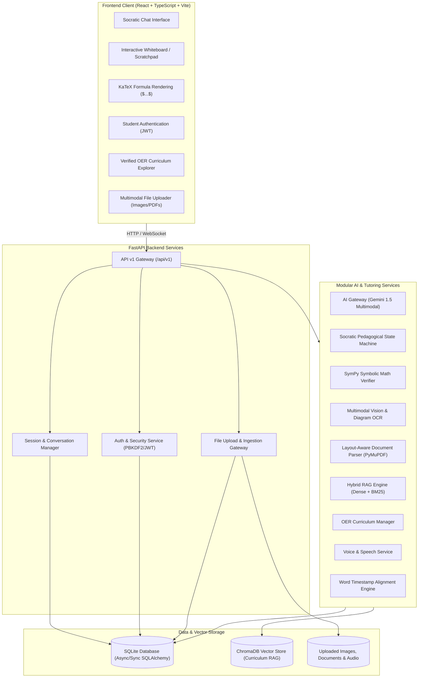

# AI-Powered Multimodal Student Tutor & Problem Solver

An intelligent, multi-turn, multimodal tutoring system engineered to guide students through complex STEM problems using the Socratic method, mathematical verification, diagram comprehension, and voice interaction.

---

## 🏛️ System Architecture



---

## 📁 Project Directory Structure

```text
ai-multimodal-tutor/
├── backend/
│   ├── app/
│   │   ├── api/
│   │   │   └── v1/
│   │   │       ├── endpoints/
│   │   │       │   ├── auth.py          # Student registration, login, /me JWT verification
│   │   │       │   ├── user.py          # Student profile management & dashboard analytics
│   │   │       │   ├── health.py        # System health & DB readiness endpoint
│   │   │       │   ├── session.py       # Tutoring session & message CRUD (Conversations)
│   │   │       │   ├── ingest.py        # Multimodal ingestion: text, images, PDF, DOCX, audio, video
│   │   │       │   ├── knowledge.py     # Educational sources registry, doc ingestion & curriculum search
│   │   │       │   ├── rag.py           # End-to-end RAG question answering, retrieval diagnostics & evaluation
│   │   │       │   ├── tutor.py         # AI Tutor endpoints: /solve, /math, /code, /study-aid, /practice, /chat
│   │   │       │   ├── validation.py    # Answer validation & hallucination control: /validate-answer, /check-citations
│   │   │       │   └── voice.py         # Text-to-speech & synchronized subtitles: /generate, /audio, /normalize
│   │   │       └── router.py            # Aggregated v1 API router
│   │   ├── core/
│   │   │   ├── config.py                # Pydantic Settings & environment config
│   │   │   ├── file_security.py         # MIME validation, size limits & sanitization
│   │   │   ├── logging.py               # Structured application logger
│   │   │   └── security.py              # PBKDF2 password hashing & HMAC-SHA256 JWT
│   │   ├── db/
│   │   │   ├── base.py                  # SQLAlchemy declarative base
│   │   │   └── session.py               # Synchronous SQLite session provider
│   │   ├── models/
│   │   │   ├── user.py                  # User / Student profile ORM model
│   │   │   ├── session.py               # StudySession & SessionMessage ORM models
│   │   │   ├── asset.py                 # UploadedAsset ORM model
│   │   │   └── knowledge.py             # EducationalSource, KnowledgeDocument, DocumentChunk, QualityReport
│   │   ├── schemas/
│   │   │   ├── health.py                # Health check response schemas
│   │   │   ├── auth.py                  # Login, registration, token schemas
│   │   │   ├── user.py                  # User profile schemas
│   │   │   ├── session.py               # Session & Message request/response schemas
│   │   │   ├── asset.py                 # Uploaded file schemas
│   │   │   ├── unified_input.py         # UnifiedQuestionPayload, SourceFileInfo & schemas
│   │   │   ├── knowledge.py             # Sources, chunks, documents, queries & quality audit schemas
│   │   │   ├── rag.py                   # RAG queries, responses, citations, diagnostics & evaluation schemas
│   │   │   ├── tutor.py                 # Pydantic models for problem solving, math, code, study aids & practice
│   │   │   ├── validation.py            # Grounding status, citation audits, source conflicts & consistency schemas
│   │   │   └── voice.py                 # TTS request/response, timestamped sentence and word segment schemas
│   │   ├── services/
│   │   │   ├── text_normalizer.py       # Whitespace & LaTeX bracket normalization
│   │   │   ├── image_processor.py       # Image preprocessing & Gemini vision OCR
│   │   │   ├── pdf_processor.py         # PyMuPDF page-aware extraction & table parser
│   │   │   ├── docx_processor.py        # python-docx structured hierarchy parser
│   │   │   ├── audio_processor.py       # Audio STT with Gemini & offline fallback
│   │   │   ├── video_processor.py       # 30s keyframe sampling & multimodal audio/visual fusion
│   │   │   ├── unified_pipeline.py      # Master input router to UnifiedQuestionPayload
│   │   │   ├── knowledge_sources.py     # Source registry & legal compliance validation
│   │   │   ├── knowledge_cleaner.py     # Text cleaning, boilerplate & duplicate removal
│   │   │   ├── knowledge_extractor.py   # Multi-format doc extractor (PDF, DOCX, HTML, TXT)
│   │   │   ├── educational_chunker.py   # Concept-aware semantic chunking with formula retention
│   │   │   ├── embedding_service.py     # Gemini text-embedding-004 + 768-dim local projection
│   │   │   ├── vector_store.py          # Persistent ChromaDB vector store collection manager
│   │   │   ├── data_quality.py          # Validation auditing for missing text & duplicate chunks
│   │   │   ├── knowledge_manager.py     # Knowledge lifecycle, duplicate detection, versioning
│   │   │   ├── query_processor.py       # Query normalization, domain classification, and expansion
│   │   │   ├── rag_retriever.py         # Hybrid retrieval (ChromaDB Dense + BM25 Sparse) & RRF reranking
│   │   │   ├── context_builder.py       # Reference cards and citation metadata mapping
│   │   │   ├── answer_generator.py      # Grounded LLM answering with anti-hallucination guardrails
│   │   │   ├── rag_service.py           # Master 5-stage RAG coordinator & latency tracker
│   │   │   ├── rag_evaluator.py         # Benchmark evaluator measuring recall@k, precision, and latency
│   │   │   ├── sympy_solver.py          # Symbolic mathematics engine: arithmetic, algebra, calculus, statistics
│   │   │   ├── code_assistant.py        # Safe static AST code analysis, complexity evaluation, debugging
│   │   │   ├── study_aid_generator.py   # Chapter summaries, key takeaways, definitions, revision notes
│   │   │   ├── practice_generator.py    # Bloom's taxonomy MCQs with distractor rationales & worked problems
│   │   │   ├── tutor_engine.py          # Master pedagogical tutor coordinator: decomposition, levels, Socratic feedback
│   │   │   ├── citation_validator.py    # Citation audit: existence, document match, valid page & canonical URLs
│   │   │   ├── source_grounding_checker.py # Factual assertion grounding & insufficient context detector
│   │   │   ├── source_conflict_detector.py # Academic convention & duality contradiction resolver (Authority hierarchy)
│   │   │   ├── answer_consistency_checker.py # Question relevance, logic flow, SymPy arithmetic & AST code safety
│   │   │   ├── answer_validator.py      # Master validation & hallucination control coordinator
│   │   │   ├── speech_normalizer.py     # Educational speech normalizer: LaTeX math, code summaries, tables, headings
│   │   │   └── voice_service.py         # Neural edge-tts voice synthesis & timestamped sentence/word aligner
│   │   └── main.py                      # FastAPI app factory, CORS & lifespan
│   ├── tests/
│   │   ├── conftest.py                  # Pytest fixtures & test client
│   │   ├── test_api.py                  # Health, Auth, Session & Upload test suite
│   │   ├── test_multimodal.py           # Comprehensive multimodal ingestion test suite
│   │   ├── test_knowledge_base.py       # Phase 4 educational knowledge base test suite
│   │   ├── test_rag.py                  # Phase 5 RAG pipeline & evaluation test suite
│   │   ├── test_tutor.py                # Phase 6 tutor, math, code, study aids & practice test suite
│   │   ├── test_validation.py           # Phase 7 answer validation, citations, conflicts & consistency test suite
│   │   └── test_voice.py                # Phase 8 TTS voice generation, subtitles & speech normalization test suite
│   ├── requirements.txt                 # Backend Python dependencies
│   ├── pytest.ini                       # Pytest test runner config
│   └── .env.example                     # Backend environment template
├── frontend/
│   ├── src/
│   │   ├── components/
│   │   │   ├── AuthModal.tsx            # Student sign in & account registration
│   │   │   ├── ChatInterface.tsx        # Multi-turn chat with LaTeX math rendering
│   │   │   ├── CurriculumView.tsx       # Verified OER curriculum explorer
│   │   │   ├── FileUploadModal.tsx      # Image, PDF & worksheet uploader
│   │   │   ├── Header.tsx               # App header with live backend status & auth
│   │   │   ├── MathRenderer.tsx         # KaTeX formula renderer for $...$ and $$...$$
│   │   │   ├── ProfileModal.tsx         # User profile and learning progress
│   │   │   ├── SessionList.tsx          # Study sessions sidebar with creation modal
│   │   │   ├── TutorResponse.tsx        # Socratic markdown answer display with KaTeX & code
│   │   │   ├── VoicePlayer.tsx          # Audio playback dock with sentence highlighting
│   │   │   └── WhiteboardCanvas.tsx     # Interactive student scratchpad & canvas
│   │   ├── pages/
│   │   │   ├── LandingPage.tsx          # Landing page with feature highlights & hero
│   │   │   ├── LoginPage.tsx            # Full-page login interface
│   │   │   ├── RegisterPage.tsx         # Registration interface with grade/subject selection
│   │   │   └── StudentDashboard.tsx     # Student dashboard with metrics & active sessions
│   │   ├── services/
│   │   │   └── api.ts                   # Type-safe API client (Auth, Sessions, Uploads)
│   │   ├── types/
│   │   │   └── index.ts                 # Shared TypeScript interfaces
│   │   ├── App.tsx                      # Main application view & tab coordinator
│   │   ├── index.css                    # Tailwind CSS base & utilities
│   │   ├── vite-env.d.ts                # Vite environment typings
│   │   └── main.tsx                     # React DOM entrypoint
│   ├── package.json                     # Frontend npm packages
│   ├── vite.config.ts                   # Vite bundler configuration
│   ├── tsconfig.json                    # TypeScript compiler options
│   ├── tailwind.config.js               # Tailwind styling configuration
│   └── .env.example                     # Frontend environment template
├── scripts/
│   ├── run_backend.ps1                  # PowerShell script to start FastAPI backend
│   └── run_frontend.ps1                 # PowerShell script to start Vite frontend
├── .env.example                         # Master environment variables template
├── .gitignore                           # Git ignore rules for Python, Node, DB & secrets
└── README.md                            # Comprehensive technical documentation
```

---

## 🚀 Getting Started

### Prerequisites
- **Python 3.11+** (Tested with Python 3.14)
- **Node.js v18+** & **npm**

### 1. Backend Setup
```bash
cd backend
python -m venv venv

# Windows PowerShell:
.\venv\Scripts\activate

# Install dependencies:
pip install -r requirements.txt

# Create environment file:
copy .env.example .env
```

### 2. Frontend Setup
```bash
cd ../frontend
npm install
copy .env.example .env
```

### 3. Running the Application

**Option A: Convenience Scripts (PowerShell)**
- Terminal 1 (Backend):
  ```powershell
  .\scripts\run_backend.ps1
  ```
- Terminal 2 (Frontend):
  ```powershell
  .\scripts\run_frontend.ps1
  ```

**Option B: Manual Commands**
- Backend:
  ```powershell
  cd backend
  .\venv\Scripts\python.exe -m uvicorn app.main:app --host 127.0.0.1 --port 8000 --reload
  ```
- Frontend:
  ```powershell
  cd frontend
  npm run dev
  ```

Interactive API documentation: [http://127.0.0.1:8000/docs](http://127.0.0.1:8000/docs).  
Application UI: [http://localhost:5173](http://localhost:5173).

---

## 🧪 Testing

To execute the backend unit test suite:
```powershell
cd backend
.\venv\Scripts\python.exe -m pytest tests/ -v
```

To build and verify the frontend application:
```powershell
cd frontend
npm run build
```

---

## 🗺️ Project Roadmap & Phase Status

| Phase | Description | Status |
| :--- | :--- | :--- |
| **Phase 0** | **Project Analysis & System Architecture** | ✅ Completed & Approved |
| **Phase 1** | **Project Setup & Foundation (FastAPI, SQLite, React, Vite, Tailwind)** | ✅ Completed & Approved |
| **Phase 2** | **Student Interface & Authentication (Dashboard, Socratic Chat, Voice Dock)** | ✅ Completed & Approved |
| **Phase 3** | **Multimodal Input Ingestion Pipeline (Text, Image, PDF, DOCX, Audio, Video)** | ✅ Completed & Approved |
| **Phase 4** | **Educational Knowledge Base Development (Source Registry, Chunking, ChromaDB)** | ✅ Completed & Approved |
| **Phase 5** | **Retrieval-Augmented Generation (RAG: Hybrid Search, Reranking, Citations)** | ✅ Completed & Approved |
| **Phase 6** | **AI Tutor and Educational Problem Solver (SymPy, AST Code, Study Aids, Practice)** | ✅ Completed & Approved |
| **Phase 7** | **Answer Validation & Hallucination Control (Grounding, Citations, Consistency)** | ✅ Completed & Approved |
| **Phase 8** | **Text-to-Speech and Synchronized Subtitles (Neural Voice, Word Alignment, Scrubber)** | ✅ Completed (Awaiting Phase 9 Approval) |
| **Phase 9** | **Student Mastery Analytics & Multi-Session Memory** | ⏳ Queued for Next Phase |
| **Phase 10** | **End-to-End Testing, Security Hardening & Documentation** | ⏳ Queued |

---

## 🎙️ Phase 8: Text-to-Speech and Synchronized Subtitles

Phase 8 elevates the student tutor into a multi-sensory educational experience by combining natural neural speech synthesis with millisecond-accurate synchronized subtitle and word highlighting.

### 1. Neural TTS Integration (`VoiceService`, `/api/v1/voice/`)
- Integrates high-fidelity Microsoft neural voices via `edge-tts` (`en-US-AriaNeural`, `en-US-GuyNeural`, `en-US-JennyNeural`, `en-US-ChristopherNeural`).
- Produces natural human cadence, conversational pacing, and accurate STEM pronunciation.
- Streams generated MP3 files directly from `./storage/audio/` via `/api/v1/voice/audio/{filename}`.

### 2. Timestamp Alignment & Subtitle Synchronizer
- Captures native 100-nanosecond tick `SentenceBoundary` events directly from the neural speech engine.
- Derives proportional word-level timestamps (`WordSegment`) bounded within the sentence duration, ensuring smooth visual tracking.
- Returns structured responses pairing original markdown display sentences with their exact start and end timestamps.

### 3. Structured Educational Speech Normalizer (`speech_normalizer.py`)
- **Mathematical LaTeX Processing:** Converts raw formulas into conversational spoken phrases:
  - `$$F = ma$$` $\rightarrow$ `"F equals m times a"`
  - `\frac{1}{2} m v^2` $\rightarrow$ `"1 over 2 m times v squared"`
  - `\sqrt{a^2 + b^2}` $\rightarrow$ `"the square root of a squared plus b squared"`
  - `\lim_{x \to 0}` $\rightarrow$ `"the limit as x approaches 0 of"`
  - `\int_{0}^{\pi}` $\rightarrow$ `"the integral from 0 to pi of"`
  - Handles Greek letters (`\theta`, `\pi`, `\mu`, `\Delta`), operators (`\times`, `\pm`, `\approx`, `\le`), and implicit multiplication (`ma`, `mc^2`).
- **Code Block Summarization:** Eliminates confusing syntax recitations (`open paren`, `curly brace`, `semicolon`), summarizing code blocks cleanly:
  *"Here is a Python code implementation defining the function binary search to execute this logic."*
- **Markdown Tables:** Flattens tabular matrices into spoken row sentences (`Row 1: [col1] is [val1]`).
- **Citation Cleaning:** Strips bracket citations (`[1]`, `[2]`, `[99]`) from spoken speech to maintain natural narrative flow.

### 4. Interactive Voice Player Dock (`VoicePlayer.tsx`)
- **Active Sentence Highlighting:** Prominently highlights the sentence actively being spoken with smooth border and background accents.
- **Word-Level Highlighting:** Dynamically animates the specific word being articulated inside the active sentence.
- **Automatic Scrolling:** Automatically scrolls long explanations to keep the active sentence continuously visible.
- **Playback Controls:** Full Play, Pause, Resume, Replay, and Previous/Next sentence navigation.
- **Timeline Scrubber:** Interactive range scrubber allowing students to drag and seek to any second of the audio, automatically realigning active sentence markers.
- **Playback Speed Selector:** Multi-speed options ($0.75\times, 1.0\times, 1.25\times, 1.5\times, 2.0\times$) adjusting both audio playback and visual progression synchronously.
- **Interactive Sentence Clicking:** Clicking any sentence in the subtitle list instantly jumps audio playback to that sentence's start timestamp.

### 5. Text-Only Mode
- Provides a one-click toggle to collapse audio playback and switch to quiet reading mode, allowing students to study without audio distraction.

### 6. Robust Fallback & Error Resilience
- If network access or cloud neural TTS is unavailable, the backend automatically transitions to `forced_alignment_fallback`.
- Accurately models academic speaking rates ($150\text{ words/minute}$) and sentence boundaries, enabling the frontend to seamlessly play via client-side `window.speechSynthesis` while maintaining 100% of the synchronized highlighting features.

### 7. Endpoints
- `POST /api/v1/voice/generate`: Converts educational markdown text into neural MP3 audio with aligned sentence and word segments.
- `GET /api/v1/voice/audio/{filename}`: Securely streams synthesized MP3 files with hash-based filename validation.
- `POST /api/v1/voice/normalize`: Returns the spoken speech script and sentence pairs without audio synthesis.

---

## 🛡️ Phase 7: Answer Validation & Hallucination Control

The validation layer operates as an automated intermediary gatekeeper positioned directly between AI answer generation and final student output. It rigorously verifies source grounding, enforces citation integrity, prevents hallucination on unindexed topics, resolves curriculum conflicts via authoritative hierarchy, and ensures mathematical and programming consistency.

### 1. Intermediary Validation Architecture (`/api/v1/validation/`)
- Intercepts answers generated by both the RAG pipeline (`rag_service`) and the pedagogical problem solver (`tutor_engine`).
- Audits and sanitizes output before returning responses to the student interface.
- Appends transparent, readable verification badges and audit notices to answers whenever discrepancies or unverified statements are detected.

### 2. Source-Grounding Verification (`SourceGroundingChecker`)
- Deconstructs answers into testable factual claims.
- Evaluates token and entity overlap against retrieved curriculum excerpts.
- Determines the exact supporting chunk and authoring body for every factual assertion.

### 3. Citation Integrity Audit (`CitationValidator`)
- **Phantom Index Detection:** Detects and flags citation markers (e.g. `[99]`) that do not exist in the retrieved curriculum context, rewriting them to `[N (Unverified Citation)]`.
- **Document & Page Matching:** Verifies that citations correspond to the actual retrieved source document and possess non-negative, valid page numbers.
- **URL Canonicalization:** Validates that bibliographic links are syntactically valid and point to approved educational domains.

### 4. Insufficient Information Handling
- The system never fabricates an answer when knowledge base coverage is missing or when retrieval confidence is below threshold.
- Automatically detects low-confidence retrieval (< 0.25) or ungrounded queries and returns a transparent disclosure:
  *"The educational knowledge base currently contains no verified curriculum materials matching this inquiry. The system will not generate unverified claims without authoritative curriculum grounding."*

### 5. Source Conflict Detection & Authority Tiering (`SourceConflictDetector`)
- Automatically detects scientific dualities and conflicting conventions among retrieved chunks (e.g. Thermodynamics First Law sign conventions $\Delta U = Q \pm W$, inclusion of zero in natural numbers $\mathbb{N}$, and standard gravitational acceleration approximations $g$).
- Implements the Phase 4 **Curriculum Authority Hierarchy**:
  1. **Tier 1 (Weight 100):** National Curriculum Bodies (NCERT).
  2. **Tier 2 (Weight 90):** Government Portals (ePathshala, NPTEL IIT Madras).
  3. **Tier 3 (Weight 80):** Official University Materials (OpenStax, MIT OpenCourseWare).
  4. **Tier 4 (Weight 70):** Official Documentation & Verified OER (Python PSF, LibreTexts).
  5. **Tier 5 (Weight 65):** Academic Preprints (arXiv).
- Resolves conflicts in favor of higher-tier authorities; if authorities are of equal tier, presents both conventions explicitly to the student.

### 6. Answer Consistency & Safety (`AnswerConsistencyChecker`)
- **Question Relevance:** Verifies that the answer substantively addresses the student's inquiry, catching off-topic or evasive responses.
- **Logical Flow:** Checks sequential continuity across step-by-step problem breakdowns.
- **Mathematical Consistency via SymPy:** Extracts arithmetic and algebraic equivalence claims (e.g. equations, deduction steps) and tests equality using symbolic simplification, intercepting erroneous calculations before presentation.
- **Programming Safety via AST:** Parses code blocks using Python `ast` to detect syntax errors, scans for disallowed system calls (`os.system`, `subprocess`, `rm -rf`, `eval`, `exec`), and flags unbounded while-loops.

### 7. Confidence & Transparency
- Rejects pseudo-scientific arbitrary confidence percentages (e.g. "98.7% accurate").
- Classifies responses into three transparent, pedagogically grounded verification tiers:
  - `SUPPORTED_BY_SOURCES`: Factual assertions are directly anchored in verified curriculum excerpts with valid citations.
  - `GENERAL_MODEL_KNOWLEDGE`: Conceptually and mathematically consistent explanation from foundation model reasoning, without specific indexed curriculum chunks.
  - `INSUFFICIENTLY_VERIFIED`: Unverified assertions, missing curriculum evidence, math discrepancies, or code safety violations flagged.

### 8. Limitations of Automated Verification
- Automated symbolic checking verifies deterministic algebraic equalities and arithmetic, but does not construct arbitrary higher-order formal proofs.
- Static AST inspection validates syntax and identifies known hazardous execution patterns, but cannot simulate dynamic runtime behavior or non-Python code blocks.
- Lexical and semantic overlap approximates source grounding, but does not replace domain-expert educator review.

### 9. Endpoints
- `POST /api/v1/validation/validate-answer`: Full end-to-end answer audit (citations, grounding, conflicts, consistency).
- `POST /api/v1/validation/check-citations`: Standalone citation marker, URL, and page validation.
- `POST /api/v1/validation/check-conflicts`: Standalone contradiction detection across retrieved curriculum chunks.
- `POST /api/v1/validation/check-consistency`: Standalone question relevance, SymPy math, and AST code safety checks.

---

## 🎓 Phase 6: AI Tutor & Educational Problem Solver

The AI Tutor transforms the platform from a generic chatbot into an active, verified pedagogical tutor. It integrates symbolic mathematical verification, safe static code analysis, cognitive study aid generation, Bloom's taxonomy practice question synthesis, and multi-turn conversational context.

### 1. Pedagogical Problem Decomposition (`/api/v1/tutor/solve`)
Every STEM explanation is structured according to a strict educational scaffold:
- **Problem Understanding:** Clarifying the core question and physics/math fundamentals in plain terms.
- **Given Information:** Explicitly cataloging all provided variables, quantities, and boundary conditions.
- **Required Result:** Identifying the exact target unknown or proof goal.
- **Step-by-Step Solution:** Numbered procedural sequence where each step features a pedagogical title, detailed explanation, mathematical formulas in KaTeX, and rationale.
- **Final Answer:** Clean, verified result highlighted for the student.
- **Why It Works:** Explaining the underlying intuition, physical laws, or mathematical theorems ensuring deep conceptual transfer.

### 2. Multi-Tier Explanation Levels
The tutor adapts its tone, rigor, and depth across three distinct learning tiers:
- `beginner`: Uses intuitive real-world analogies, minimizes heavy mathematical jargon, and guides step-by-step.
- `intermediate`: Standard high-school and undergraduate curriculum depth, balancing equations, standard theorems, and structured derivations.
- `advanced`: Rigorous university-level exposition incorporating formal axiomatic proofs, asymptotic behavior, domain restrictions, and structural constraints.

### 3. Symbolic Mathematics Engine (`SymPySolver`, `/api/v1/tutor/math`)
To guarantee exact mathematical precision without LLM hallucination, the backend employs **SymPy 1.14**:
- **Arithmetic:** Exact rational arithmetic ($\frac{a}{b}$) preventing floating-point imprecision.
- **Algebra:** Symbolic polynomial factorization, quadratic formula derivations, and multi-variable equation solving.
- **Calculus:** Symbolic derivatives ($\frac{d}{dx}$), definite & indefinite integrals ($\int f(x) dx$), and one-sided/two-sided limits ($\lim_{x \to a} f(x)$).
- **Statistics:** Population & sample mean ($\mu$), median, variance ($\sigma^2, s^2$), and standard deviation ($\sigma, s$).
- **LaTeX Step Generation:** Each transformation produces intermediate LaTeX expressions for visual presentation in the student UI.

### 4. Safe Static Programming Assistant (`CodeAssistant`, `/api/v1/tutor/code`)
Provides safe, isolated software engineering guidance **without executing arbitrary submitted code on the host**:
- **AST Parsing:** Uses Python's native `ast` module for deterministic static code inspection.
- **Time Complexity Evaluation:** Analyzes AST loop nesting depth to determine Big-O complexity ($O(1), O(\log n), O(n), O(n^2), O(n^3)$).
- **Recursion Detection:** Tracks recursive function invocations and identifies potential stack exhaustion risks.
- **Syntax Error Localization:** Traps `SyntaxError` with line and column numbers and provides student-friendly remediation hints.
- **Anti-Pattern & Bug Detection:** Identifies Python anti-patterns such as mutable default arguments (`def f(x=[])`) and potential infinite loops (`while True` lacking `break`).

### 5. Educational Document Assistance & Study Aids (`StudyAidGenerator`, `/api/v1/tutor/study-aid`)
Synthesizes educational reading material into structured learning aids:
- **Executive Summaries:** High-level conceptual overview of chapters or technical articles.
- **Key Takeaways:** High-yield bullet points prioritizing core testable insights.
- **Glossary & Definitions:** Curated terminology dictionary mapping domain concepts to formal definitions.
- **Revision Notes:** Condensed study sheets with mnemonics, common exam pitfalls, and essential review points.

### 6. Practice Question Generator (`PracticeGenerator`, `/api/v1/tutor/practice`)
Generates active recall materials categorized by **Bloom's Revised Taxonomy** (`Remember`, `Understand`, `Apply`, `Analyze`, `Evaluate`, `Create`):
- **Multiple Choice Questions (MCQs):** Exactly 4 distinct options, correct index, and educational rationales explaining why distractors are incorrect.
- **Worked Problems & Rubrics:** Open-ended problems with comprehensive scoring criteria and step-by-step rubrics.

### 7. Multi-Turn Socratic Tutor Chat (`TutorEngine`, `/api/v1/tutor/chat`)
- Retains multi-turn conversation context across student queries by persisting dialogue history in SQLite (`SessionMessage`).
- Integrates Phase 5 RAG hybrid curriculum search to cite verified NCERT/OER sources.
- Employs the Socratic method to provide guiding hints rather than simply giving away homework answers.

---

## 🧠 Phase 5: Retrieval-Augmented Generation (RAG) Pipeline

The RAG pipeline grounds student tutoring answers strictly in verified educational curricula, enforcing verifiable citations and proactive uncertainty communication.

### 1. Multi-Stage RAG Architecture (`/api/v1/rag/`)
- **Stage 1 (Query Processing):** Standardizes bracket LaTeX expressions, classifies query intent (`definition`, `formula_lookup`, `step_by_step_solution`, `conceptual_explanation`), identifies STEM subject domain, and enriches queries via educational synonym expansion.
- **Stage 2 (Hybrid Retrieval):** Dual-engine search combining **ChromaDB Dense Semantic Search** (768-dim cosine similarity) and **Okapi BM25 Sparse Lexical Search** across indexed curriculum chunks.
- **Stage 3 (Reciprocal Rank Fusion & Reranking):** Merges candidate lists using RRF ($RRF(d) = \sum \frac{1}{60 + rank(d)}$) and applies cross-feature reranking with structural heading affinity and formula alignment bonuses.
- **Stage 4 (Context Construction):** Assembles structured reference cards with source titles, chapters, sections, exact page numbers, and canonical URLs.
- **Stage 5 (Grounded Synthesis & Citations):** Instructs the LLM (Gemini 1.5 Flash with deterministic local fallback) to answer strictly from reference cards using numbered footnote citations (`[1]`, `[2]`), without fabricating sources or facts.
- **Uncertainty Communication Guardrail:** When curriculum materials do not contain sufficient context, the pipeline detects the low confidence score and returns a transparent uncertainty response, preventing hallucinated answers on unindexed topics.

### 2. Endpoints
- `POST /api/v1/rag/query`: Primary student inquiry endpoint returning grounded explanation with verified citations.
- `POST /api/v1/rag/retrieve`: Standalone diagnostic retrieval endpoint for inspecting dense, BM25, and rerank scores.
- `POST /api/v1/rag/evaluate`: Automated benchmarking endpoint evaluating recall@k, citation validity, uncertainty accuracy, and latency.

---

## 📚 Phase 4: Educational Knowledge Base Architecture

The educational knowledge base system decouples tutoring answers from pure LLM memory, anchoring all reasoning in legally verified curricula.

### 1. Authoritative Source Registry (`/api/v1/knowledge/sources`)
- Pre-seeded with official, legally compliant educational sources across 6 categories:
  - **NCERT Resources:** Mathematics Grade 10, Physics Grade 11, Chemistry Grade 12 (Fair Dealing).
  - **Government Educational Portals:** ePathshala, NPTEL IIT Madras (CC BY-NC-SA 4.0).
  - **Official University Materials:** OpenStax University Physics & Calculus (CC BY 4.0), MIT OpenCourseWare (CC BY-NC-SA 4.0).
  - **Open Educational Resources (OER):** LibreTexts STEM, Khan Academy.
  - **Official Programming Documentation:** Python 3 Official Docs (PSF License), MDN Web Docs (CC-BY-SA 2.5+).
  - **Academic Research Sources:** arXiv.org Open STEM Preprints.

### 2. Multi-Format Ingestion Pipeline (`/api/v1/knowledge/documents/ingest`)
- **Supported Formats:** PDF (PyMuPDF), DOCX (python-docx), HTML (BeautifulSoup4), and TXT/Markdown.
- **Structural Extraction:** Preserves heading hierarchies (H1-H4), tables as Markdown grids, exact page numbers, and LaTeX equations (`$...$`, `$$...$$`).
- **Boilerplate & Noise Cleaning:** Automatically detects and removes textbook running headers, footers, duplicate lines, and publisher watermarks.

### 3. Concept-Aware Semantic Chunking
- Splits content along natural sentence and concept boundaries without bisecting mathematical formulas.
- Automatically isolates major chapters and sections to prevent concept bleeding across unrelated topics.
- Every chunk embeds immutable metadata: `document_id`, `source_id`, `chapter`, `section`, `page_number`, `extracted_math`, and `sha256_hash`.

### 4. Vector Storage & High-Dimension Embeddings
- **ChromaDB Vector Store:** Embedded persistent HNSW vector indexing located in `./storage/vector_store` under the `educational_curriculum` collection.
- **Dual-Tier Embeddings:** 768-dimensional normalized dense vectors via Google Gemini `text-embedding-004` (cloud) or high-resolution feature hashing projection (offline deterministic fallback).

### 5. Knowledge Lifecycle & Quality Validation
- **Duplicate Document Detection:** Computes SHA-256 file checksums before ingestion; prevents redundant indexing.
- **Document Versioning & Re-indexing:** Increments version (`v1`, `v2`, etc.), automatically purges outdated chunks from ChromaDB and SQLite, and indexes updated materials.
- **Data Quality Audits (`/api/v1/knowledge/quality/reports`):** Validates documents for missing text (< 50 chars), duplicate chunk hashes, unsupported formats, and missing metadata.
- **Curriculum Search (`POST /api/v1/knowledge/query`):** Executes semantic similarity matching and formats verifiable academic citations:
  `"[Source Name], [Chapter], [Section], Page [X] ([Authority]) - License: [License]"`.

---

## 📥 Phase 3: Multimodal Ingestion Pipeline

The multimodal ingestion layer normalizes all student input channels into a single standardized schema: `UnifiedQuestionPayload`.

### 1. Ingestion Endpoints (`/api/v1/ingest/`)
- `POST /text`: Whitespace cleaning, bracket LaTeX delimiter conversion (`\[...\]` $\rightarrow$ `$$...$$`, `\(...\)` $\rightarrow$ `$`), equation detection, and academic domain routing.
- `POST /image`: Pillow contrast stretching, auto-orientation deskew, Gemini 1.5 Flash Vision OCR extracting handwritten formulas and geometric diagrams.
- `POST /pdf`: PyMuPDF layout-aware text extraction, table extraction (`find_tables`), page-indexed academic citation anchors.
- `POST /docx`: `python-docx` heading hierarchy parsing, table restructuring into markdown grids, paragraph grouping.
- `POST /audio`: Direct Gemini multimodal audio STT with offline fallback and student transcript confirmation flag.
- `POST /video`: 30-second keyframe sampling strategy, visual blackboard OCR + audio track transcription fusion, timestamped reference anchors.
- `POST /unified`: Master polymorph endpoint detecting MIME category automatically and dispatching to the appropriate parser.

### 2. File Security Safeguards (`app/core/file_security.py`)
- **Strict Size Limits:** Text (64 KB), Image (20 MB), PDF (50 MB), DOCX (25 MB), Audio (25 MB), Video (100 MB).
- **MIME & Extension Enforcement:** Whitelist-based validation preventing executable uploads and spoofed extensions.
- **Path Sanitization:** Filename sanitization with UUID prefixes preventing directory traversal.
- **Temporary Cleanup:** Automatic resource cleanup on failed extractions.
