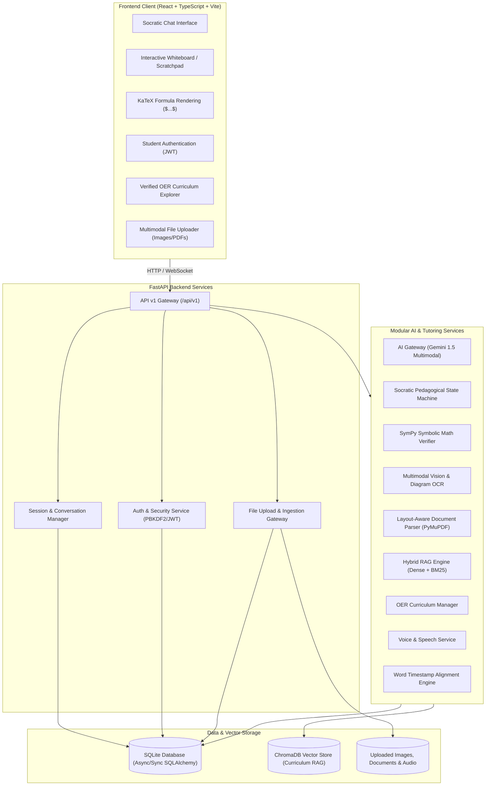

# AI-Powered Multimodal Student Tutor & Problem Solver

An intelligent, multi-turn, multimodal tutoring system engineered to guide students through complex STEM problems using the Socratic method, mathematical verification, diagram comprehension, and voice interaction.

---

## 🏛️ System Architecture



---

## 📁 Project Directory Structure

```text
ai-multimodal-tutor/
├── backend/
│   ├── app/
│   │   ├── api/
│   │   │   └── v1/
│   │   │       ├── endpoints/
│   │   │       │   ├── auth.py          # Student registration, login, /me JWT verification
│   │   │       │   ├── user.py          # Student profile management
│   │   │       │   ├── health.py        # System health & DB readiness endpoint
│   │   │       │   ├── session.py       # Tutoring session & message CRUD (Conversations)
│   │   │       │   └── ingest.py        # File, image & document upload foundation
│   │   │       └── router.py            # Aggregated v1 API router
│   │   ├── core/
│   │   │   ├── config.py                # Pydantic Settings & environment config
│   │   │   ├── logging.py               # Structured application logger
│   │   │   └── security.py              # PBKDF2 password hashing & HMAC-SHA256 JWT
│   │   ├── db/
│   │   │   ├── base.py                  # SQLAlchemy declarative base
│   │   │   └── session.py               # Engine and sessionmaker provider
│   │   ├── models/
│   │   │   ├── user.py                  # User / Student profile ORM model
│   │   │   ├── session.py               # StudySession & SessionMessage ORM models
│   │   │   └── asset.py                 # UploadedAsset ORM model
│   │   ├── schemas/
│   │   │   ├── health.py                # Health check response schemas
│   │   │   ├── auth.py                  # Login, registration, token schemas
│   │   │   ├── user.py                  # User profile schemas
│   │   │   ├── session.py               # Session & Message request/response schemas
│   │   │   └── asset.py                 # Uploaded file schemas
│   │   ├── services/
│   │   │   ├── ai_gateway.py            # Gemini 1.5 Flash/Pro LLM Gateway
│   │   │   ├── socratic_engine.py       # Socratic hint progression state machine
│   │   │   ├── sympy_verifier.py        # Symbolic algebraic verification
│   │   │   ├── vision_ocr.py            # Multimodal handwriting & diagram OCR
│   │   │   ├── doc_parser.py            # PyMuPDF PDF & DOCX layout-aware parser
│   │   │   ├── rag_engine.py            # Hybrid RAG retrieval engine
│   │   │   ├── knowledge_base.py        # Verified OER & curriculum manager
│   │   │   ├── voice_service.py         # Faster-Whisper & Edge-TTS voice service
│   │   │   └── subtitle_aligner.py      # Word timestamp offset alignment engine
│   │   └── main.py                      # FastAPI app factory, CORS & lifespan
│   ├── tests/
│   │   ├── conftest.py                  # Pytest fixtures & async test client
│   │   └── test_api.py                  # Health, Auth, Session & Upload test suite
│   ├── requirements.txt                 # Backend Python dependencies
│   ├── pytest.ini                       # Pytest test runner config
│   └── .env.example                     # Backend environment template
├── frontend/
│   ├── src/
│   │   ├── components/
│   │   │   ├── AuthModal.tsx            # Student sign in & account registration
│   │   │   ├── ChatInterface.tsx        # Multi-turn chat with LaTeX math rendering
│   │   │   ├── CurriculumView.tsx       # Verified OER curriculum explorer
│   │   │   ├── FileUploadModal.tsx      # Image, PDF & worksheet uploader
│   │   │   ├── Header.tsx               # App header with live backend status & auth
│   │   │   ├── MathRenderer.tsx         # KaTeX formula renderer for $...$ and $$...$$
│   │   │   ├── SessionList.tsx          # Study sessions sidebar with creation modal
│   │   │   └── WhiteboardCanvas.tsx     # Interactive student scratchpad & canvas
│   │   ├── services/
│   │   │   └── api.ts                   # Type-safe API client (Auth, Sessions, Uploads)
│   │   ├── types/
│   │   │   └── index.ts                 # Shared TypeScript interfaces
│   │   ├── App.tsx                      # Main application view & tab coordinator
│   │   ├── index.css                    # Tailwind CSS base & utilities
│   │   ├── vite-env.d.ts                # Vite environment typings
│   │   └── main.tsx                     # React DOM entrypoint
│   ├── package.json                     # Frontend npm packages
│   ├── vite.config.ts                   # Vite bundler configuration
│   ├── tsconfig.json                    # TypeScript compiler options
│   ├── tailwind.config.js               # Tailwind styling configuration
│   └── .env.example                     # Frontend environment template
├── scripts/
│   ├── run_backend.ps1                  # PowerShell script to start FastAPI backend
│   └── run_frontend.ps1                 # PowerShell script to start Vite frontend
├── .env.example                         # Master environment variables template
├── .gitignore                           # Git ignore rules for Python, Node, DB & secrets
└── README.md                            # Comprehensive technical documentation
```

---

## 🚀 Getting Started

### Prerequisites
- **Python 3.11+** (Tested with Python 3.14)
- **Node.js v18+** & **npm**

### 1. Backend Setup
```bash
cd backend
python -m venv venv

# Windows PowerShell:
.\venv\Scripts\activate

# Install dependencies:
pip install -r requirements.txt

# Create environment file:
copy .env.example .env
```

### 2. Frontend Setup
```bash
cd ../frontend
npm install
copy .env.example .env
```

### 3. Running the Application

**Option A: Convenience Scripts (PowerShell)**
- Terminal 1 (Backend):
  ```powershell
  .\scripts\run_backend.ps1
  ```
- Terminal 2 (Frontend):
  ```powershell
  .\scripts\run_frontend.ps1
  ```

**Option B: Manual Commands**
- Backend:
  ```powershell
  cd backend
  .\venv\Scripts\python.exe -m uvicorn app.main:app --host 127.0.0.1 --port 8000 --reload
  ```
- Frontend:
  ```powershell
  cd frontend
  npm run dev
  ```

Interactive API documentation: [http://127.0.0.1:8000/docs](http://127.0.0.1:8000/docs).  
Application UI: [http://localhost:5173](http://localhost:5173).

---

## 🧪 Testing

To execute the backend unit test suite:
```powershell
cd backend
.\venv\Scripts\python.exe -m pytest tests/ -v
```

To build and verify the frontend application:
```powershell
cd frontend
npm run build
```

---

## 🗺️ Project Roadmap & Phase Status

| Phase | Description | Status |
| :--- | :--- | :--- |
| **Phase 0** | **System Architecture & Technical Blueprint** | ✅ Completed & Approved |
| **Phase 1** | **Project Setup & Foundation (Backend, Frontend, DB, Auth, Uploads)** | ✅ Completed |
| **Phase 2** | **Multimodal Input Ingestion Pipeline (Image, OCR, PDF/DOCX & Math Parsing)** | ⏳ Queued for Approval |
| **Phase 3** | **Video Lecture Processing Engine** | ⏳ Queued |
| **Phase 4** | **Socratic Tutoring Engine & Symbolic Math Verification (SymPy + Gemini)** | ⏳ Queued |
| **Phase 5** | **Knowledge Retrieval & Verifiable RAG System (ChromaDB + Textbook Indexing)**| ⏳ Queued |
| **Phase 6** | **Conversational Voice Pipeline & Synchronized Subtitles** | ⏳ Queued |
| **Phase 7** | **Interactive Multimodal Student UI & Whiteboard Integration** | ⏳ Queued |
| **Phase 8** | **Student Mastery Analytics & Multi-Session Memory** | ⏳ Queued |
| **Phase 9** | **End-to-End Testing, Security Hardening & Documentation** | ⏳ Queued |
