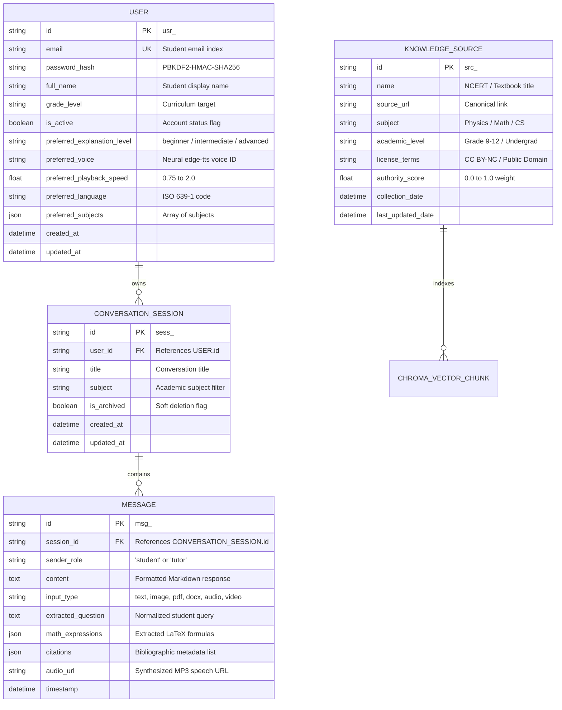

# Database Architecture & Schema Specification

## 1. Overview

The AI Tutor persistent storage layer is built using **SQLAlchemy 2.0 ORM** supporting **PostgreSQL 16** in production with connection pooling (`pool_size=10`, `max_overflow=20`, `pool_recycle=1800`), alongside **SQLite 3** for local development and high-speed in-memory unit testing.

---

## 2. Entity-Relationship Diagram (ERD)

---

## 3. Detailed Table Specifications

### 3.1 `users` Table
Stores student identity, encrypted credentials, and personalized learning defaults.

| Column Name | Type | Constraints | Description |
| :--- | :--- | :--- | :--- |
| `id` | `VARCHAR(36)` | `PRIMARY KEY` | Unique student UUID prefix `usr_` |
| `email` | `VARCHAR(255)` | `UNIQUE, NOT NULL, INDEX` | Lowercase sanitized login email |
| `password_hash` | `VARCHAR(255)` | `NOT NULL` | PBKDF2 with 100,000 SHA256 iterations & salt |
| `full_name` | `VARCHAR(128)` | `NOT NULL` | Student display name |
| `grade_level` | `VARCHAR(64)` | `NOT NULL` | Educational grade level |
| `is_active` | `BOOLEAN` | `DEFAULT TRUE` | Active account status |
| `preferred_explanation_level`| `VARCHAR(32)`| `DEFAULT 'intermediate'` | Default explanation difficulty |
| `preferred_voice` | `VARCHAR(64)` | `DEFAULT 'en-US-AriaNeural'` | Preferred neural TTS speech model |
| `preferred_playback_speed` | `FLOAT` | `DEFAULT 1.0` | Default voice playback speed |
| `preferred_language` | `VARCHAR(16)` | `DEFAULT 'en'` | Spoken language localization |
| `preferred_subjects` | `JSON` | `DEFAULT '[]'` | Focus subjects for hybrid search priority |
| `created_at` | `DATETIME` | `NOT NULL` | Account creation timestamp |
| `updated_at` | `DATETIME` | `NOT NULL` | Last profile update timestamp |

### 3.2 `conversation_sessions` Table
Maintains conversational context and threads for multi-turn learning.

| Column Name | Type | Constraints | Description |
| :--- | :--- | :--- | :--- |
| `id` | `VARCHAR(36)` | `PRIMARY KEY` | Session UUID prefix `sess_` |
| `user_id` | `VARCHAR(36)` | `FOREIGN KEY (users.id) ON DELETE CASCADE, INDEX` | Owning student user ID |
| `title` | `VARCHAR(255)` | `NOT NULL` | Session title |
| `subject` | `VARCHAR(64)` | `NOT NULL, INDEX` | Educational subject domain |
| `is_archived` | `BOOLEAN` | `DEFAULT FALSE` | Soft-deletion flag |
| `created_at` | `DATETIME` | `NOT NULL` | Session creation timestamp |
| `updated_at` | `DATETIME` | `NOT NULL` | Last turn activity timestamp |

### 3.3 `messages` Table
Records user queries, multimodal inputs, step-by-step tutor solutions, and speech URLs.

| Column Name | Type | Constraints | Description |
| :--- | :--- | :--- | :--- |
| `id` | `VARCHAR(36)` | `PRIMARY KEY` | Message UUID prefix `msg_` |
| `session_id` | `VARCHAR(36)` | `FOREIGN KEY (conversation_sessions.id) ON DELETE CASCADE, INDEX` | Thread reference |
| `sender_role` | `VARCHAR(16)` | `NOT NULL` | Sender: `student` or `tutor` |
| `content` | `TEXT` | `NOT NULL` | Formatted Markdown message body |
| `input_type` | `VARCHAR(32)` | `DEFAULT 'text'` | Input modality: `text`, `image`, `pdf`, `docx`, `audio`, `video` |
| `extracted_question`| `TEXT` | `NULLABLE` | Normalized text extracted from multimodal inputs |
| `math_expressions` | `JSON` | `DEFAULT '[]'` | LaTeX math expressions identified in the turn |
| `citations` | `JSON` | `DEFAULT '[]'` | Bibliographic references with page numbers |
| `audio_url` | `VARCHAR(512)`| `NULLABLE` | Cached neural speech audio file path |
| `timestamp` | `DATETIME` | `NOT NULL, INDEX` | Turn generation timestamp |

### 3.4 `knowledge_sources` Table
Maintains registry of authoritative educational curricula.

| Column Name | Type | Constraints | Description |
| :--- | :--- | :--- | :--- |
| `id` | `VARCHAR(36)` | `PRIMARY KEY` | Source UUID prefix `src_` |
| `name` | `VARCHAR(255)` | `NOT NULL` | Textbook or curriculum title |
| `source_url` | `VARCHAR(512)`| `NULLABLE` | Canonical link |
| `subject` | `VARCHAR(64)` | `NOT NULL, INDEX` | Subject domain |
| `academic_level` | `VARCHAR(64)` | `NOT NULL` | Curriculum grade target |
| `license_terms` | `VARCHAR(128)`| `NOT NULL` | Licensing status |
| `authority_score`| `FLOAT` | `DEFAULT 1.0` | Authority weighting for conflict resolution |
| `collection_date`| `DATETIME` | `NOT NULL` | Initial ingestion date |
| `last_updated_date`| `DATETIME` | `NOT NULL` | Last update check date |

---

## 4. Migration Strategy & Production Connection Management

1. **Alembic Database Migrations:** Schema changes are version-controlled in `/backend/alembic/versions`.
2. **Connection Pooling Configuration:**
   - Production PostgreSQL uses SQLAlchemy's `QueuePool`.
   - `pool_size = 10`: Standard concurrent database connections.
   - `max_overflow = 20`: Temporary burst connections during peak usage.
   - `pool_recycle = 1800`: Recycles idle sockets every 30 minutes to prevent stale disconnections.
   - `pool_pre_ping = True`: Issues `SELECT 1` ping before borrowing from pool to ensure liveness.
3. **Data Isolation & Security:**
   - Multi-tenant data segregation enforced at the ORM layer using `user_id` filters on all `Session` queries.
   - `ON DELETE CASCADE` ensures student account deletions purge all messages, sessions, and associated files without orphan data leakage.

