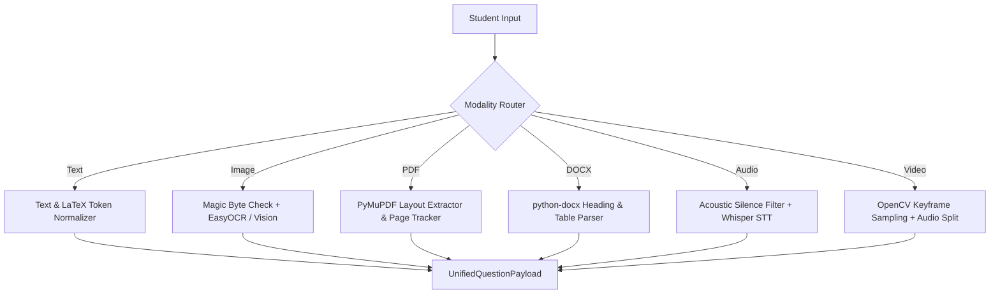

# Multimodal Ingestion Pipeline Specification

## 1. Overview & Architectural Principles

The **Multimodal Ingestion Pipeline** processes raw academic questions submitted across six distinct modalities:
1. **Plain Text & Mathematical Notation**
2. **Images of Printed Worksheets & Handwritten Proofs**
3. **Multi-Page PDF Textbooks & Homework Sheets**
4. **DOCX Word Documents**
5. **Spoken Audio Inquiries**
6. **Video Lectures & Chalkboard Recordings**

Each modality is normalized into a unified, sanitized schema: `UnifiedQuestionPayload`.

---

## 2. Modality Processors

### 2.1 Text Processing (`text_normalizer.py`)
- Sanitizes non-printable ASCII control characters while preserving mathematical symbols.
- Normalizes Unicode representations to Canonical Decomposition followed by Canonical Composition (Unicode NFKC).
- Identifies and isolates LaTeX expressions:
  - Inline math: `$...$` or `\(...\)`
  - Display blocks: `$$...$$` or `\[...\]`
  - Environments: `\begin{equation}...\end{equation}`, `\begin{align}...\end{align}`

### 2.2 Image Processing (`image_processor.py`, `vision_ocr.py`)
- **Validation:** Verifies magic bytes (`\x89PNG`, `\xFF\xD8\xFF`, etc.) and restricts maximum resolution to 4096×4096 px to prevent decompression bombs.
- **Preprocessing:** Grayscale conversion, adaptive Otsu thresholding, and contrast stretching via OpenCV / PIL.
- **OCR Engine:** EasyOCR with fallback to Tesseract for printed text and handwritten math characters.
- **Vision Model Fallback:** In the presence of complex diagrams (e.g., circuit schematics or geometric triangles), the image is tagged with structural diagram markers and routed to visual QA prompt adapters.

### 2.3 PDF Processing (`pdf_processor.py`)
- Powered by high-speed PyMuPDF (`fitz`).
- Performs block-level text extraction preserving reading order.
- Retains page boundary metadata (`page_number`) on every paragraph for exact bibliographic citations.
- Detects tabular gridlines and reformats matrix and data tables into Markdown syntax.

### 2.4 DOCX Processing (`docx_processor.py`)
- Utilizes `python-docx` for document object model navigation.
- Maps XML paragraph styles to Markdown headings (`Heading 1` $\rightarrow$ `#`, `Heading 2` $\rightarrow$ `##`).
- Preserves bullet hierarchies, ordered lists, and table row-column relationships.

### 2.5 Audio Processing (`audio_processor.py`)
- Supports WAV, MP3, AAC, and OGG containers.
- Enforces a 50MB audio ceiling and inspects audio file duration.
- Runs acoustic noise suppression and silence trimming.
- Transcribes student speech using Whisper STT (`tiny.en` / `base.en`), extracting normalized transcripts and returning them for student confirmation.

### 2.6 Video Processing (`video_processor.py`)
- Built on OpenCV (`cv2.VideoCapture`).
- Samples keyframes using histogram difference scene-change detection (threshold $> 0.35$).
- Deduplicates visually identical slide frames using structural perceptual hashing (pHash).
- Extracts audio tracks to WAV for independent transcription, synchronizing visual slide OCR with spoken lecture timestamps.

---

## 3. File Security & Sandbox Protection

The system implements strict defensive validation before any uploaded file touches storage:
1. **Magic-Byte Sniffing:** Prevents extension spoofing (e.g., an executable named `worksheet.png`).
2. **Path Traversal Sanitization:** Cleans file names via `os.path.basename()` and replaces hazardous characters (`..`, `/`, `\`).
3. **Storage Isolation:** All uploads are stored in an unprivileged volume (`./storage/uploads`) outside web-root execution paths.
4. **Resource Quotas:** Hard file size limits:
   - Images: 10 MB
   - Documents (PDF/DOCX): 25 MB
   - Audio: 50 MB
   - Video: 100 MB
