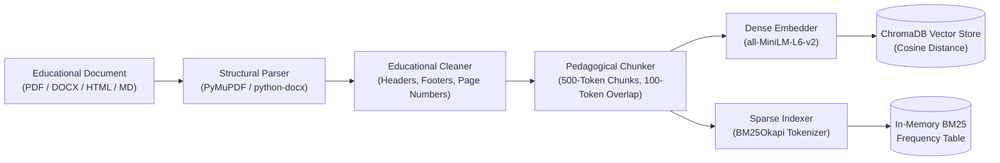

# Curriculum Knowledge Base & Hybrid RAG Architecture

## 1. Pedagogical Knowledge Collection & Curation

The **AI-Powered Educational Knowledge Base** provides authoritative grounding for secondary and undergraduate STEM curricula (Mathematics, Physics, Chemistry, Biology, and Computer Science). Unlike consumer LLM search wrappers, this architecture strictly prevents ungrounded hallucinations by indexing peer-reviewed textbooks, NCERT resources, and official documentation into an immutable vector database.

### 1.1 Source Registry (`KnowledgeSource`)
Every ingested document is cataloged with bibliographic metadata:
- **Canonical Name & Identifier:** E.g., `NCERT Class 11 Physics Chapter 5 Laws of Motion`
- **Source URL & Digital Object Identifier (DOI):** Direct link to canonical PDF/HTML
- **Academic Domain & Target Grade:** Class 9 to Undergraduate University
- **License & Rights:** Creative Commons (CC BY-NC), Public Domain, or Open Educational Resource (OER)
- **Authority Score ($W_{auth} \in [0.8, 1.0]$):** Used to resolve cross-source conflicting facts

---

## 2. Ingestion & Preprocessing Pipeline



### 2.1 Content Extraction & Cleaning
1. **Header & Footer Stripping:** Removes repetitive publisher headers, copyright notices, and page numbering artifacts.
2. **Formula Normalization:** Protects inline (`$...$`) and block (`$$...$$`) LaTeX equations from destructive character splitting.
3. **Table Structure Preservation:** Converts tabular layout data into standardized GitHub Flavored Markdown tables.

### 2.2 Pedagogical Chunking Strategy
- **Target Chunk Size:** 500 tokens (~350 words).
- **Chunk Overlap:** 100 tokens (~70 words) to guarantee theorem proofs and multi-step equations span cleanly across chunk boundaries.
- **Boundary Preservation:** Splits prioritize major headings (`#`, `##`), then paragraph breaks (`\n\n`), then sentence periods (`. `).

---

## 3. Hybrid Dense-Sparse Retrieval Engine

Pure semantic search often fails on precise mathematical formulas (e.g., differentiating $x^2 + 5x + 6$ from $x^2 - 5x + 6$). Conversely, pure keyword search fails on conceptual questions (e.g., "Why does an apple fall from a tree?"). Our engine employs **Dual Hybrid Retrieval**:

### 3.1 Dense Semantic Search
- **Embedding Model:** `sentence-transformers/all-MiniLM-L6-v2` (384-dimensional vector space).
- **Metric:** Cosine Similarity in ChromaDB:
  $$\text{sim}_{\text{dense}}(q, d) = \frac{\mathbf{e}_q \cdot \mathbf{e}_d}{\|\mathbf{e}_q\| \|\mathbf{e}_d\|}$$

### 3.2 Sparse Keyword Search (BM25Okapi)
- Calculates term frequency and inverse document frequency with length normalization ($k_1=1.5, b=0.75$):
  $$\text{score}_{\text{BM25}}(q, d) = \sum_{t \in q} \text{IDF}(t) \cdot \frac{f(t, d) \cdot (k_1 + 1)}{f(t, d) + k_1 \cdot \left(1 - b + b \cdot \frac{|d|}{\text{avgdl}}\right)}$$

### 3.3 Reciprocal Rank Fusion (RRF)
Ranks from both dense and sparse retrieval passes are fused using Reciprocal Rank Fusion ($k=60$):
$$\text{RRF\_Score}(d) = \frac{1}{60 + \text{rank}_{\text{dense}}(d)} + \frac{1}{60 + \text{rank}_{\text{BM25}}(d)}$$

---

## 4. Citation Generation & Context Injection

Retrieved chunks are formatted into structured XML context tags for the LLM prompt:
```xml
<context>
  <chunk id="1" source="NCERT Class 11 Physics" chapter="Laws of Motion" page="93" url="...">
    Newton's second law of motion states that the rate of change of momentum of a body is
    directly proportional to the applied force and takes place in the direction in which the
    force acts: F = dp/dt = m*a.
  </chunk>
</context>
```

The system prompt strictly commands the LLM:
1. Every factual statement must cite its enclosing chunk via `[Source Name, Chapter X, p. Y]`.
2. Never extrapolate or invent scientific claims beyond the provided context.
3. If the retrieved context is insufficient or out-of-domain, explicitly state:
   *"The current curriculum knowledge base contains insufficient context to authoritatively verify this question."*

---

## 5. RAG Evaluation Benchmark

The system includes an automated evaluation harness (`rag_evaluator.py`) computing standard Information Retrieval metrics across test queries:
- **Mean Reciprocal Rank (MRR@5):** Measures how high the first relevant textbook chunk appears.
- **Normalized Discounted Cumulative Gain (NDCG@5):** Evaluates ranking quality.
- **Context Relevance Precision:** Validates absence of extraneous noise.
- **Citation Faithfulness Score:** Fraction of generated statements verified by chunk sentences.
