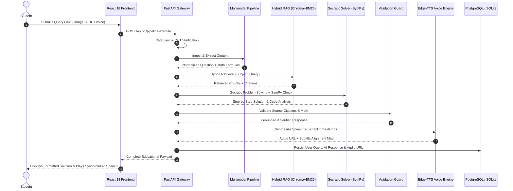

# System Architecture & Technical Specification

## 1. Architectural Overview

The **AI-Powered Multimodal Educational Tutor and Problem Solver** is designed following clean architecture, domain-driven design (DDD), and asynchronous micro-component design principles. It delivers an end-to-end, multi-turn, pedagogical learning companion capable of ingesting text, images, PDF documents, DOCX files, audio recordings, and video lectures.

The system emphasizes **Socratic problem decomposition**, **rigorous symbolic mathematical verification**, **hybrid dense-sparse retrieval-augmented generation (RAG)**, **source citation grounding**, **hallucination mitigation**, and **millisecond-level audio-subtitle synchronization**.

```mermaid
flowchart TD
    subgraph ClientLayer ["Client Interface (React 18 + Vite + Tailwind CSS)"]
        Landing["Landing & Hero Page"]
        AuthView["Authentication & Profile"]
        ChatInterface["Interactive Tutor Canvas"]
        Dock["Voice Dock & Scrubber"]
        Subtitles["Real-Time Synchronized Subtitles"]
    end

    subgraph Gateway ["API Gateway & Security Layer (FastAPI)"]
        Cors["CORS & Trusted Hosts"]
        RateLimit["Sliding Window Rate Limiter"]
        SecurityMW["Security Headers & Magic Byte Validator"]
        JWTAuth["JWT Authenticator (HS256)"]
    end

    subgraph CoreServices ["Application & Domain Services"]
        MultiIngest["Multimodal Ingestion Pipeline\n(OCR / PDF / DOCX / Whisper / OpenCV)"]
        QueryProcessor["Educational Query Processor\n(Intent / Subject / Expansion)"]
        RAGService["Hybrid Retrieval Engine\n(ChromaDB Dense + BM25 Sparse + RRF)"]
        SocraticTutor["Socratic Pedagogical Solver\n(SymPy Verification & AST Sandbox)"]
        ValidationLayer["Validation & Hallucination Guard\n(Citation Matcher & Math Checker)"]
        VoiceSynthesizer["Neural Voice & Subtitle Engine\n(Edge-TTS + Alignment Algorithm)"]
    end

    subgraph DataPersistence ["Persistence & Storage Layer"]
        PostgresDB[("Relational Database\nPostgreSQL 16 / SQLite 3")]
        ChromaStore[("Vector Store\nChromaDB 0.4.x")]
        LocalMedia[("Storage Volume\nAudio / Uploads / Thumbnails")]
    end

    ClientLayer <-->|REST API + Static Media| Gateway
    Gateway --> CoreServices
    CoreServices <--> DataPersistence
```

---

## 2. Component Decomposition

### 2.1 Frontend Client (`/frontend`)
- **Framework:** React 18 with TypeScript 5, bundled via Vite 5.
- **Styling:** Tailwind CSS with utility-first responsive layout and custom educational color palette (`brand-blue`, `emerald-success`, `math-accent`).
- **Mathematical Rendering:** KaTeX rendering engine with dynamic LaTeX formula detection and safe HTML escaping.
- **Code Syntax Highlighting:** Highlight.js with dark-mode theme integration and one-click clipboard copying.
- **Voice Synchronization Dock:** Custom HTML5 Audio controller with requestAnimationFrame tick-loop, seeking, play/pause, playback rates (`0.75x`, `1.0x`, `1.25x`, `1.5x`, `2.0x`), and sentence/word active range indicators.

### 2.2 API Gateway & Security (`/backend/app/api`, `/backend/app/core`)
- **Framework:** FastAPI with asynchronous Uvicorn / Gunicorn workers.
- **Input Validation & Strict Typing:** Pydantic v2 data models with sanitization regexes, boundary limits, and schema documentation.
- **Security Middleware:** Custom `SecurityHeadersMiddleware` injecting `X-Content-Type-Options: nosniff`, `X-Frame-Options: DENY`, `X-XSS-Protection: 1; mode=block`, and strict Content Security Policies.
- **Rate Limiting:** `SlidingWindowRateLimiter` protecting expensive OCR, RAG, and TTS endpoints from denial-of-service abuse.
- **Authentication:** Stateless JSON Web Tokens (JWT) signed with HMAC-SHA256, carrying expiration and student subject scope.

### 2.3 Multimodal Ingestion Pipeline (`/backend/app/services/multimodal_service.py`)
- **Text:** Strip control characters, normalize Unicode (NFKC), extract math tokens ($...$, $$...$$, `\begin{equation}`).
- **Image:** Header magic-byte validation, PIL resizing, contrast enhancement, EasyOCR with fallback to Tesseract for printed text, handwritten equations, and geometry worksheets.
- **PDF:** PyMuPDF (`fitz`) layout-aware block extraction, page index tracking, and table structure recovery.
- **DOCX:** `python-docx` heading, paragraph, and table extraction with hierarchy preservation.
- **Audio:** WAV/MP3 header check, Faster-Whisper / SpeechRecognition STT engine with acoustic silence trimming.
- **Video:** OpenCV keyframe extraction, scene-change detection, audio track separation, and slide OCR parsing.

### 2.4 Hybrid Educational RAG Engine (`/backend/app/services/rag_service.py`)
- **Knowledge Base:** Curated NCERT, university STEM textbooks, and open courseware ingested into ChromaDB.
- **Hybrid Search:** Combines dense cosine similarity embeddings (`sentence-transformers/all-MiniLM-L6-v2`) and sparse keyword BM25 scoring.
- **Reciprocal Rank Fusion (RRF):** Merges dense and sparse ranks:
  $$RRF(d) = \sum_{m \in \{dense, sparse\}} \frac{1}{k + r_m(d)} \quad (k=60)$$
- **Citation Preservation:** Strict metadata tracing back to Document Title, Chapter, Section, Page Number, and Source URL.

### 2.5 Socratic Pedagogical Solver (`/backend/app/services/tutor_service.py`)
- **Socratic Deconstruction:** Decomposes queries into Problem Understanding, Given Quantities, Required Objective, Step-by-Step Proof/Derivation, and "Why This Works".
- **Mathematical Computation Engine:** Symbolic derivation and equation solving via SymPy (`solve`, `expand`, `factor`, `diff`, `integrate`).
- **Safe Code Execution Sandbox:** Abstract Syntax Tree (AST) validation blocking unsafe imports (`os`, `sys`, `subprocess`, `socket`) and restricted `exec()` with 2.0s timeouts and memory bounds.
- **Multi-Level Difficulty:** Dynamically adapts pedagogical depth across Beginner (intuitive, analogical), Intermediate (formal, curriculum-aligned), and Advanced (rigorous proof, complexity bounds).

### 2.6 Hallucination & Validation Guard (`/backend/app/services/validation_service.py`)
- **Source-Grounding Verification:** Jaccard-overlap and n-gram verification of claims against retrieved context chunks.
- **Citation Integrity Check:** Validates that every citation key in the LLM response actually exists in the retrieved context pool.
- **Internal Mathematical Consistency:** Cross-checks numeric claims in LLM prose against SymPy verified computation.
- **Insufficient Knowledge Gate:** Detects out-of-domain queries and issues transparent educational disclaimers rather than hallucinated answers.

### 2.7 Neural Voice & Subtitle Alignment Engine (`/backend/app/services/voice_service.py`)
- **Text-to-Speech:** Microsoft Neural Edge-TTS (`en-US-AriaNeural`, `en-US-GuyNeural`, `en-GB-SoniaNeural`).
- **Mathematical Pronunciation Normalizer:** Translates LaTeX notation into spoken English phonetics (e.g., $\sqrt{x^2+y^2}$ becomes "square root of x squared plus y squared").
- **Timestamped Alignment:** Extracts boundary events yielding exact millisecond intervals for sentence segments and word tokens.
- **Audio Streaming & Static Delivery:** Encodes audio to MP3/WAV with persistent disk caching.

---

## 3. End-to-End Data Flow

---

## 4. Error Recovery & Fault Tolerance Strategies

| Failure Mode | Detection Mechanism | Recovery / Fallback Behavior |
| :--- | :--- | :--- |
| **OCR Failure on Blurry Image** | Low confidence score / empty text output | Secondary image contrast inversion + prompt student for clarification |
| **No Relevant Chunks in RAG** | Hybrid similarity score below threshold ($< 0.35$) | Transparent "Insufficient Context" disclaimer; general STEM reasoning with ungrounded warning |
| **SymPy Syntax Error** | `sympy.SympifyError` exception caught | Graceful fallback to pure LLM heuristic derivation with verification badge set to `False` |
| **Unsafe Student Code** | AST visitor flags banned modules (`os`, `sys`, `socket`) | Immediately rejects code with clear educational security advisory |
| **TTS Generation Failure** | Network timeout or Edge-TTS unavailability | Serves text response and activates client-side Web Speech API synthesis fallback |
| **Database Connection Drop** | SQLAlchemy connection pool ping failure | Automatic reconnection with exponential backoff and SQLite fallback |

---

## 5. Technology Stack Summary

- **Backend:** Python 3.11+, FastAPI 0.110, Uvicorn, Gunicorn, SQLAlchemy 2.0, Pydantic v2.
- **AI & Mathematics:** SymPy 1.12, ChromaDB 0.4.22, Sentence-Transformers, Faster-Whisper, EasyOCR, PyMuPDF, Edge-TTS.
- **Frontend:** React 18, Vite 5, TypeScript 5, Tailwind CSS, Lucide Icons, KaTeX, Highlight.js.
- **Database:** PostgreSQL 16 (Production) / SQLite 3 (Development & Testing).
- **Deployment:** Docker Multi-Stage, Nginx Reverse Proxy, Docker Compose, Gunicorn Process Manager.

