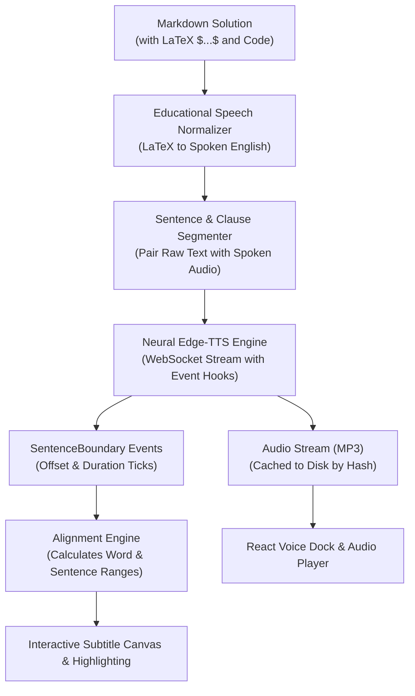

# Neural Text-to-Speech & Millisecond Subtitle Synchronization

## 1. Overview & Pedagogical Value

For students with auditory, ADHD, or ESL learning profiles, simultaneous multisensory engagement—hearing a tutor explain a concept while watching the corresponding sentence and word highlight in real time—drastically improves comprehension and retention.

The **AI Tutor Voice & Synchronization Engine** implements an end-to-end pipeline:
1. **Mathematical Speech Normalization:** Translates complex mathematical notation, LaTeX symbols, and code into natural spoken English.
2. **Neural Text-to-Speech:** Generates human-like intonation via Microsoft Neural Edge-TTS (`en-US-AriaNeural`, `en-US-GuyNeural`, etc.).
3. **Exact Timestamp Alignment:** Captures boundary events directly from the neural synthesis stream down to the millisecond.
4. **Client-Side Smooth Scrubbing & Highlighting:** React canvas with `requestAnimationFrame` loop synchronizing visual state to HTML5 audio ticks.



---

## 2. Educational Speech Normalization (`speech_normalizer.py`)

A standard TTS engine pronounces `x^2 - 5*x + 6 = 0` as *"x caret two minus five asterisk x plus six equals zero"*, which is disorienting for students. The **Speech Normalizer** parses mathematical structures into natural spoken mathematics:

| Mathematical Structure | Raw LaTeX / Code | Spoken Academic English |
| :--- | :--- | :--- |
| **Exponents** | `x^2`, `y^{n+1}` | *"x squared"*, *"y to the power of n plus 1"* |
| **Fractions** | `\frac{a}{b}`, `\frac{1}{2}` | *"a over b"*, *"one half"* |
| **Square Roots** | `\sqrt{x^2 + y^2}` | *"square root of x squared plus y squared"* |
| **Integrals** | `\int_{0}^{\infty} f(x) dx` | *"the integral from 0 to infinity of f of x with respect to x"* |
| **Summations** | `\sum_{i=1}^{n} i^2` | *"summation of i squared from i equals 1 to n"* |
| **Derivatives** | `\frac{dy}{dx}`, `f'(x)` | *"derivative of y with respect to x"*, *"f prime of x"* |
| **Greek Letters** | `\alpha, \beta, \theta, \Delta` | *"alpha, beta, theta, delta"* |
| **Relations** | `\neq, \leq, \geq, \approx` | *"is not equal to"*, *"less than or equal to"*, *"approximately"* |

---

## 3. Timestamped Alignment Algorithm (`voice_service.py`)

### 3.1 Neural Boundary Capture
The synthesis engine connects asynchronously to Edge-TTS:
```python
comm = edge_tts.Communicate(text=spoken_script, voice=voice, rate=rate)
async for chunk in comm.stream():
    if chunk["type"] == "audio":
        audio_bytes.extend(chunk["data"])
    elif chunk["type"] == "SentenceBoundary":
        # Contains exact offset and duration in 100-nanosecond ticks
        boundary_events.append(chunk)
```

### 3.2 Conversion from Nanosecond Ticks to Seconds
Edge-TTS outputs time in 100-nanosecond units ($10^7 \text{ ticks} = 1.0 \text{ second}$):
$$T_{\text{seconds}} = \frac{\text{offset\_ticks}}{10,000,000}$$

### 3.3 Word-Level Interpolation & Token Mapping
Within each sentence boundary $[T_{\text{start}}, T_{\text{end}}]$, words are segmented with duration proportional to character count and syllabic weight:
$$\Delta t_w = (T_{\text{end}} - T_{\text{start}}) \cdot \frac{\text{len}(w) + 1}{\sum_{i} (\text{len}(w_i) + 1)}$$

---

## 4. Frontend Interactive Synchronizer (`VoiceDock.tsx`)

The React frontend maintains a high-performance audio synchronization loop:
- **Frame Loop:** Uses `requestAnimationFrame` to query `audioElement.currentTime` at 60 FPS without React re-render thrashing.
- **Active Sentence Detection:** Binary search over sorted `sentence_segments` identifying $i$ where $\text{start}_i \le t < \text{end}_i$.
- **Active Word Glow:** Highlights the current spoken word with a luminous emerald outline (`#10B981`).
- **Interactive Scrubber:** Dragging the progress bar seeks audio and immediately jumps visual highlight to the exact corresponding sentence.
- **Speed Pitch Preservation:** Changing playback rate (`0.75x` to `2.0x`) maintains natural pitch without robotization.
- **Browser Speech Fallback:** When offline or on mobile browsers without streaming support, the player seamlessly falls back to the Web Speech Synthesis API.

